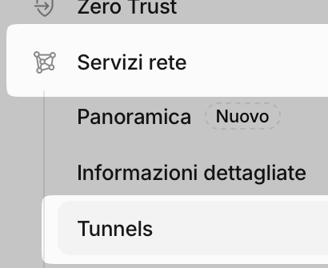
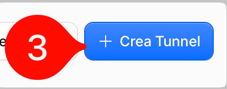
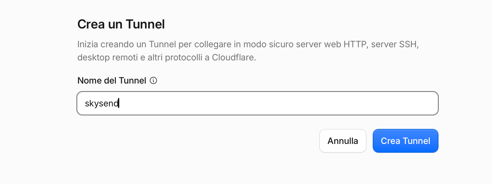
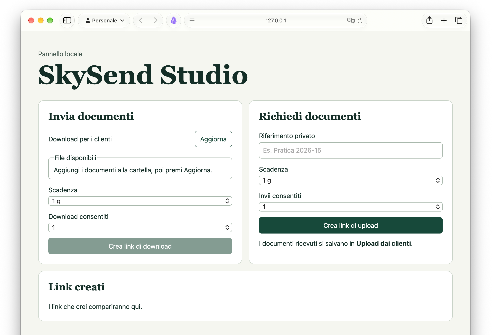
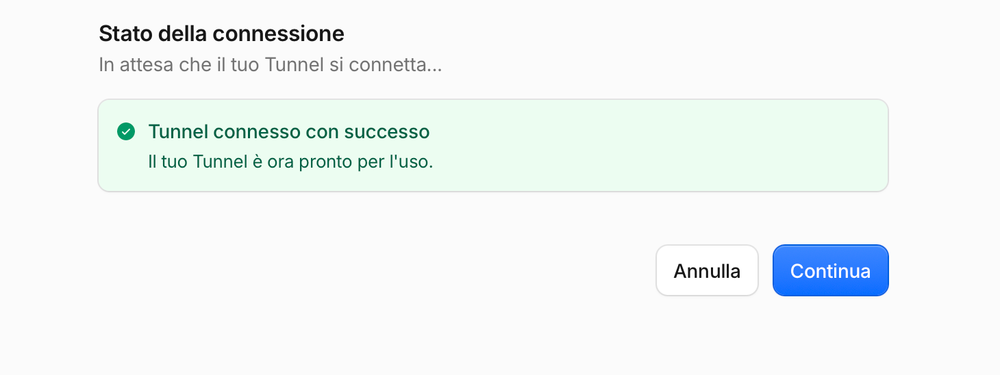
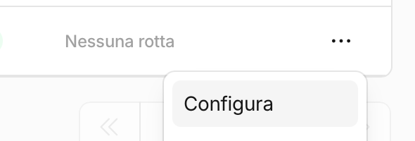
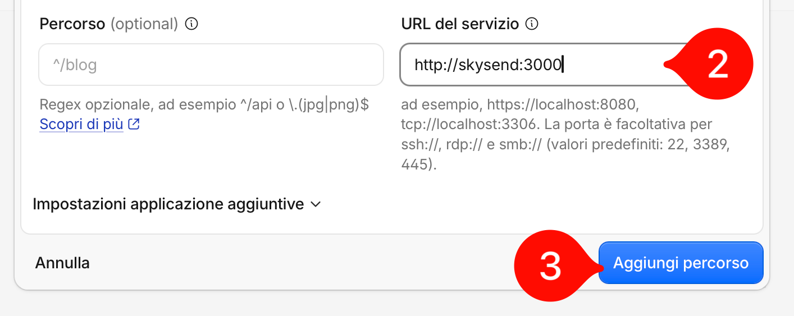
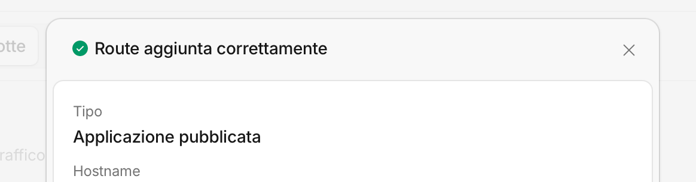
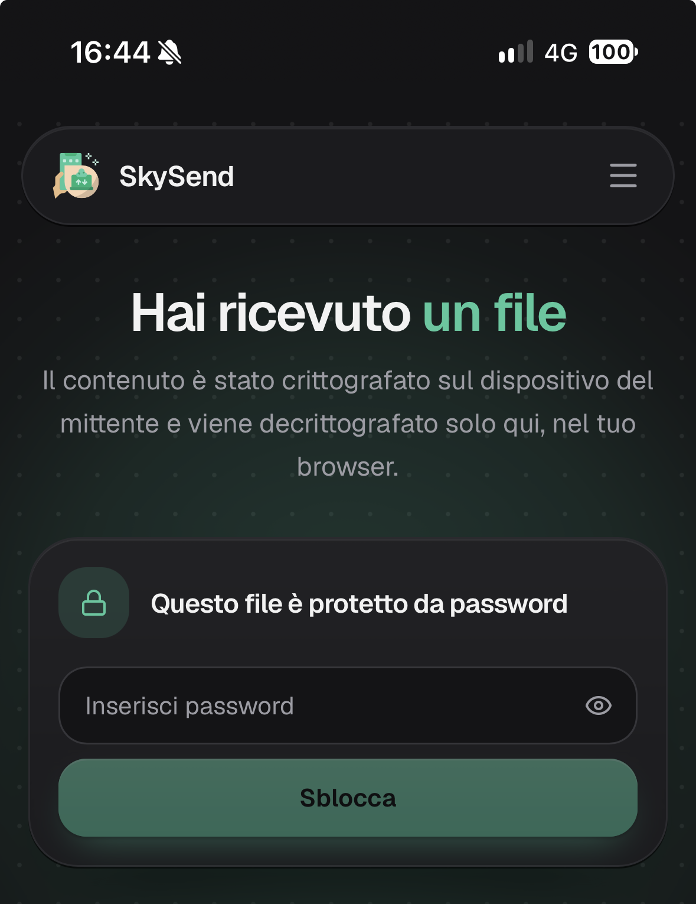
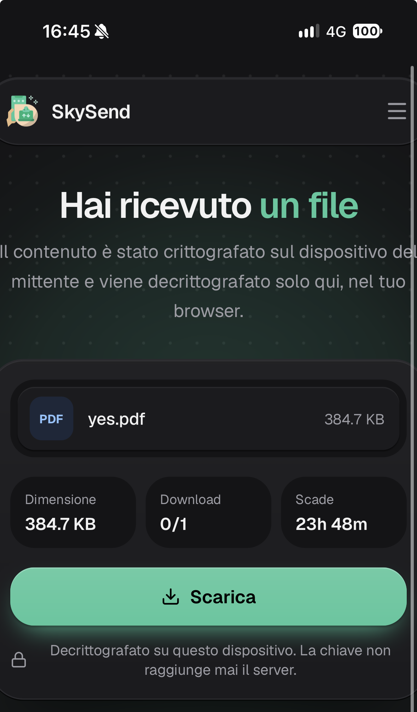

# SkySend Studio

Dal tuo computer crei link per inviare o ricevere documenti. Il cliente apre il link nel browser e usa soltanto la pagina che gli hai mandato. Il pannello dello studio si apre su **http://127.0.0.1:8787**, un indirizzo del tuo computer.

Il progetto è pensato per **un professionista per installazione**. Ogni collega usa il proprio sottodominio, tunnel e cartelle. Per usare i link, il computer che ospita SkySend deve restare acceso, con Docker attivo e connesso a Internet. Il browser dello studio può essere chiuso.

**Per pubblicare i link su Internet con questa configurazione serve un dominio proprio con il DNS gestito da Cloudflare.** Puoi usare un dominio già registrato altrove e aggiungerlo a Cloudflare. [Requisiti di Cloudflare Tunnel](https://developers.cloudflare.com/tunnel/get-started/#prerequisites)

Su GitHub scegli **Code → Download ZIP**, estrai la cartella e fai doppio clic su [Guida SkySend.html](Guida%20SkySend.html) per aprire la **guida illustrata per Mac**. Tieni la guida nella cartella estratta, così il browser trova anche le schermate. La guida copre installazione, invio, ricezione e primo collaudo. I passaggi per Windows e Linux sono [più sotto](#windows-e-linux).

SkySend Studio usa SkySend per cifrare e trasferire i file. Le personalizzazioni di questo repository sono state realizzate con l’ausilio dell’intelligenza artificiale. Comprendono il pannello locale, le due cartelle di lavoro con salvataggio automatico dei file ricevuti, l’avvio guidato su Mac e il filtro che espone ai clienti le sole funzioni di trasferimento.

## Prima installazione su Mac

Installa e apri OrbStack e verifica che il tuo dominio sia già aggiunto all’account Cloudflare. **Dopo aver copiato il token, avvia `Avvia SkySend.command` prima di aggiungere la rotta.** Lo script avvia `cloudflared`, il connettore del tunnel. Quando si collega, Cloudflare abilita **Continua**. [OrbStack](https://orbstack.dev/) · [Guida Cloudflare](https://developers.cloudflare.com/tunnel/get-started/#create-a-tunnel)

### 1. Crea il tunnel in Cloudflare

Nel pannello Cloudflare apri **Servizi rete → Tunnels → Crea Tunnel**. Nell’interfaccia inglese il menu si chiama **Networking**.





Nel campo **Nome del Tunnel**, scrivi `skysend` e premi **Crea Tunnel**. Se hai già creato il tunnel, selezionalo dall’elenco e scegli **Aggiungi una replica** (*Add a replica*) per ritrovare il comando che contiene il token. [Come recuperare il token](https://developers.cloudflare.com/tunnel/reference/tunnel-tokens/#get-the-token)



### 2. Copia il token da Cloudflare

In **Configura ambiente**, seleziona **Docker** anche se stai usando un Mac. Usa l’icona a destra di **Run tunnel with Docker** per copiare il comando. Se ti serve vedere la riga intera, incollala in un editor di testo e seleziona **solo la stringa che inizia per `eyJ` dopo `--token`**. Incollala poi nell’avvio guidato. Il comando `docker run` è il riferimento da cui prendere il token. SkySend Studio avvierà il connettore con il proprio Compose. [Token di Cloudflare Tunnel](https://developers.cloudflare.com/tunnel/reference/tunnel-tokens/#get-the-token)


### 3. Avvia SkySend e attendi la connessione

Lascia aperta la scheda di Cloudflare. Fai doppio clic su **Avvia SkySend.command**, incolla il token e inserisci il sottodominio che pubblicherai al passo successivo, per esempio `invii.studio.it`. Premi Invio per scegliere `Documenti/SkySend` oppure indica un’altra cartella. Si apre il pannello locale. Durante il primo avvio Docker può impiegare qualche minuto a scaricare le immagini.



In OrbStack, sotto il progetto **skysend**, puoi vedere i quattro servizi in esecuzione.


Se macOS non apre il file con un doppio clic, apri il Terminale nella cartella del progetto ed esegui `bash "Avvia SkySend.command"`. A questo punto il pannello locale può già funzionare mentre il sottodominio aspetta ancora la rotta. Torna alla scheda Cloudflare e attendi **Tunnel connesso con successo**, quindi premi **Continua**.



### 4. Collega il sottodominio al tunnel

Dopo **Continua**, se Cloudflare torna all’elenco dei tunnel, cerca `skysend`. **Sano** (*Healthy*) indica che il connettore è attivo. **Nessuna rotta** è lo stato atteso prima di pubblicare il sottodominio. Apri il tunnel dal suo nome o scegli **⋯ → Configura**. [Pubblicazione della rotta](https://developers.cloudflare.com/tunnel/get-started/#publish-an-application)



Nella scheda **Rotte**, premi **Aggiungi rotta**.


Seleziona **Applicazione pubblicata** (*Published application*).


Compila questi campi e verifica che **Hostname completo** coincida con il sottodominio inserito nello script.

| Campo | Valore |
| --- | --- |
| Sottodominio | `invii`, se hai scelto `invii.studio.it` |
| Dominio | `studio.it`, nell’esempio |
| Percorso | Lascia vuoto |
| URL del servizio | `http://skysend:3000`. Se ci sono due campi, scegli **HTTP** e scrivi `skysend:3000`. |

Premi **Aggiungi percorso**. Cloudflare conferma l’aggiunta della rotta e crea automaticamente il record DNS CNAME. [DNS delle applicazioni pubblicate](https://developers.cloudflare.com/tunnel/concepts/routing/#published-applications)





Prova un link cliente con un file fittizio. I browser dei clienti devono poter aprire i link direttamente. Se avevi configurato un’applicazione Cloudflare Access che richiede il login su tutto il sottodominio, rimuovi da quella rotta il requisito di login.

Il token permette a chi lo possiede di eseguire un connettore per il tuo tunnel. Su Mac l’avvio guidato lo conserva sotto `~/Library/Application Support/SkySend Studio Tunnel`, fuori da Documenti e dalla cartella dati che usa il pannello. Se la versione precedente usava `secrets/tunnel-token` dentro il progetto, ruota il token in Cloudflare e incolla quello nuovo quando richiesto. Se il token precedente è stato condiviso, disconnetti anche gli eventuali connettori sconosciuti. [Token di Cloudflare Tunnel](https://developers.cloudflare.com/tunnel/reference/tunnel-tokens/)

### Se avevi la versione con login online

I due volumi SkySend conservano gli invii esistenti. Prima dell’aggiornamento, salva i documenti già arrivati nelle inbox delle vecchie richieste e chiudi quelle ancora aperte. Il nuovo pannello registra e scarica automaticamente dalle richieste che crei al suo interno. I vecchi link del cliente continuano a dipendere dalla loro scadenza e dai limiti originali.

## Da usare ogni giorno

- **Per inviare**, copia i file in **Download per i clienti** e selezionali nel pannello. In **Scadenza**, scrivi il numero di giorni da **1 a 15** oppure seleziona **5 minuti** o **1 ora**. Premi **Crea link di download** e invia al cliente il link e la password su canali separati. I valori iniziali sono **1 giorno** e **un download**. Puoi revocare il link dal pannello.
- **Per ricevere**, inserisci un riferimento per te, ad esempio un numero di pratica. Scrivi da **1 a 15** nel campo **Scadenza in giorni** e premi **Crea link di upload**. Invia al cliente quel link. Il riferimento resta sul tuo computer. Quando il cliente carica i documenti, SkySend Studio li salva in una sottocartella di **Upload dai clienti**, anche a browser chiuso. Più file nello stesso invio arrivano in uno ZIP. La richiesta propone un invio entro **1 giorno** e si può chiudere dal pannello. Chi ha ricevuto il link può usarlo finché è attivo e ci sono invii disponibili. [Richieste di file SkySend](https://docs.skysend.app/user-guide/file-requests)


Prova prima con un file fittizio. Apri entrambi i link cliente in una finestra privata e controlla che il file ricevuto compaia nella cartella corretta. Se Cloudflare ha una regola che forza la cache, escludi il sottodominio di SkySend da quella regola. [Cache Rules di Cloudflare](https://developers.cloudflare.com/cache/how-to/cache-rules/create-dashboard/)

### Come scarica il cliente dal cellulare

Il cliente apre il link nel browser del telefono. Il percorso è stato verificato anche su rete mobile (4G).

| 1. Sblocca il file | 2. Scarica il file |
| --- | --- |
| Inserisci la password ricevuta separatamente e tocca **Sblocca**. | Controlla il nome del file e tocca **Scarica**. |
|  |  |

### Come carica i file il cliente dal cellulare

Il cliente apre il link di upload nel browser del telefono. Nella prova su rete 4G, uno ZIP da **154,9 MB** ha impiegato alcuni minuti e la pagina ha mostrato **Consegnato**.

| 1. Seleziona i file | 2. Attendi il caricamento | 3. Verifica la conferma |
| --- | --- | --- |
| Seleziona uno o più file e tocca **Cifra e invia**. | Lascia aperta la pagina mentre SkySend cifra e carica i file. | Il messaggio **Consegnato** conferma l’invio. |
|  |  |  |

### Dove stanno i dati

- I documenti decifrati sono nelle **due cartelle di lavoro**. Il pannello legge la cartella dei file da inviare e scrive in quella dei file ricevuti. Se `Documenti` è sincronizzata con iCloud, scegli durante l’installazione una cartella di lavoro fuori da iCloud Drive per tenere quelle copie sul computer. [Apple Support](https://support.apple.com/en-asia/109344)
- I dati dello studio, le password e le chiavi necessarie ad aprire le inbox sono nel database locale in `~/Library/Application Support/SkySend Studio` su Mac. Il database del pannello conta sui permessi del sistema e sulla protezione del disco. Tieni privata questa cartella e le sue eventuali copie. Serve per recuperare il pannello e le richieste dopo un cambio di computer.
- Il server conserva i file cifrati in due volumi Docker, `skysend_skysend_data` e `skysend_skysend_uploads`. Si possono vedere in **Finder → OrbStack → docker → volumes**. Per una copia coerente ferma l’applicazione ed esporta entrambi i volumi. [Volumi in OrbStack](https://docs.orbstack.dev/docker/file-sharing) · [Dati e backup SkySend](https://docs.skysend.app/user-guide/self-hosting/data-backups)

## Windows e Linux

Il Compose usa container Linux standard. Su Windows usa **Docker Desktop con WSL 2** e tieni progetto, cartelle di lavoro e stato nel filesystem della distribuzione WSL. Puoi aprire le cartelle da Esplora file con `explorer.exe .` in WSL. Su Linux usa **Docker Engine 28 o successivo** e il plugin Compose. L’avvio guidato con doppio clic è per macOS. [Docker Desktop e WSL](https://docs.docker.com/desktop/features/wsl/) · [Porte Docker pubblicate localmente](https://docs.docker.com/engine/network/port-publishing/)

Segui i passi 1 e 2 per creare il tunnel e copiare il token. Per avviare i container, apri un terminale Linux o WSL nella cartella del progetto ed esegui questi comandi.

```sh
umask 077
cp -n .env.example .env
mkdir -p 'lavoro/Download per i clienti' 'lavoro/Upload dai clienti' stato secrets
chmod 700 stato secrets
```

Apri `.env` e sostituisci `SKYSEND_HOSTNAME` con il tuo sottodominio, senza `https://`. Imposta `SKYSEND_UID` e `SKYSEND_GID` ai valori restituiti da `id -u` e `id -g`. Salva il solo token in `secrets/tunnel-token`. Poi esegui:

```sh
chmod 644 secrets/tunnel-token
docker compose up -d --remove-orphans --wait
```

Quando Cloudflare rileva la connessione, torna al [passo 4](#4-collega-il-sottodominio-al-tunnel) per aggiungere la route. Apri **http://127.0.0.1:8787** nel tuo browser. Le due cartelle sono dentro `lavoro` e i dati privati del pannello sono in `stato`. Su questo progetto il collaudo è stato eseguito su OrbStack.

## Diagnosi

- **Pannello chiuso.** Riapri `Avvia SkySend.command` su Mac o visita direttamente `http://127.0.0.1:8787` se Docker è già attivo.
- **Il browser dice che il server non esiste, anche se Cloudflare conferma la rotta.** Apri **DNS → Record** nel dominio e verifica che esista il CNAME per il sottodominio che hai inserito nello script. Subito dopo la creazione, alcuni resolver DNS possono ancora ricordare la risposta precedente. Prova il link da un’altra rete, per esempio dal cellulare con il Wi-Fi spento, e riprova più tardi dalla rete abituale. [Diagnosi DNS Cloudflare](https://developers.cloudflare.com/dns/troubleshooting/dns-issues/#newly-created-record-still-does-not-resolve)
- **Il pannello funziona e il link cliente è irraggiungibile.** In Cloudflare verifica che il tunnel sia **Healthy** e che la route punti a `http://skysend:3000`. In Terminale, da questa cartella, puoi vedere lo stato con `docker --context orbstack compose ps` e il connettore con `docker --context orbstack compose logs --tail=40 cloudflared`. Su Linux e Windows ometti `--context orbstack`.
- **Devi cambiare sottodominio o cartella di lavoro.** Su Mac esegui `bash "Avvia SkySend.command" --configura`. Per sostituire anche il token usa `--configura-token`.
- **Devi fermare l’invio e la ricezione.** Usa `docker --context orbstack compose stop` su Mac o `docker compose stop` su Linux o Windows.

Il [Compose](./compose.yaml) descrive i quattro servizi. Il [Caddyfile](./Caddyfile) elenca le operazioni ammesse dal tunnel e reindirizza a HTTPS le visite in HTTP. La cartella [gateway](./gateway/) contiene il filtro che porta al server anche le navigazioni interne del browser verso schermate riservate. Il server pubblico risponde `404` su queste pagine, compresa la home. Le chiavi delle richieste, le password e i documenti in chiaro restano sul computer dello studio. Dopo un aggiornamento di SkySend, ripeti il collaudo di upload e download con file di prova.
