# SkySend Studio

SkySend Studio aiuta avvocati e altri professionisti a scambiare documenti con i clienti. Puoi inviare un fascicolo, chiedere i documenti per una pratica e decidere per quanto tempo il link sarà disponibile e quante volte si potrà usare. Il cliente apre il link nel suo browser, anche dal cellulare.

In questa configurazione crei e chiudi i link dal **pannello riservato sul tuo Mac**. Le due cartelle di lavoro separano i file che vuoi inviare da quelli che SkySend salva automaticamente quando arrivano. Cloudflare rende raggiungibili su Internet le pagine dei clienti. Il pannello di studio resta accessibile solo dal computer che ospita SkySend.

## Indice

- [Scarica il progetto sul tuo Mac](#scarica-il-progetto-sul-tuo-mac)
- [Prima installazione su Mac](#prima-installazione-su-mac)
- [Da usare ogni giorno](#da-usare-ogni-giorno)
  - [Inviare documenti a un cliente](#inviare-documenti-a-un-cliente)
  - [Chiedere documenti a un cliente](#chiedere-documenti-a-un-cliente)
- [Prima prova con un file fittizio](#prima-prova-con-un-file-fittizio)
- [Problemi comuni](#problemi-comuni)
- [Windows e Linux](#windows-e-linux)
- [Dati e manutenzione](#dati-e-manutenzione)
- [Come è stato realizzato](#come-è-stato-realizzato)

## Scarica il progetto sul tuo Mac

1. Da questa pagina GitHub, premi il pulsante verde **Code** e scegli **Download ZIP**. Puoi anche usare il [link diretto per scaricare tutti i file](https://github.com/avvocati-e-mac/skysend-studio/archive/refs/heads/main.zip).
2. Sul Mac, apri **Finder → Download**. Fai doppio clic su **skysend-studio-main.zip** per estrarlo. Se vedi già la cartella **skysend-studio-main**, apri direttamente quella.
3. Dentro la cartella estratta, fai doppio clic su **Guida SkySend.html**. Si apre nel browser con le istruzioni illustrate. Nella stessa cartella trovi **Avvia SkySend.command**, il file da aprire quando arrivi al passo 3 dell’installazione.

Conserva tutta la cartella estratta. Contiene i file necessari all’avvio e le immagini della guida. Le cartelle in cui metterai i documenti vengono create a parte al primo avvio.

## Prima installazione su Mac

Prima di iniziare, installa e apri **OrbStack**, l’app che tiene in esecuzione SkySend sul Mac. Per far funzionare i link dei clienti su Internet, serve **un dominio tuo configurato su Cloudflare**, cioè con il DNS gestito da Cloudflare. Puoi aggiungervi un dominio che hai già acquistato altrove. Scegli un indirizzo da dedicare agli invii, ad esempio `invii.studio.it` se il tuo dominio è `studio.it`. Ogni collega configura il proprio indirizzo e le proprie cartelle. [Scarica OrbStack](https://orbstack.dev/) · [Requisiti di Cloudflare](https://developers.cloudflare.com/tunnel/get-started/#prerequisites)

### 1. Crea il tunnel in Cloudflare

Il **tunnel** è il collegamento che permette ai clienti di raggiungere i loro link. Nel pannello Cloudflare apri **Servizi rete → Tunnels → Crea Tunnel**. In inglese, **Servizi rete** si chiama **Networking**. Scrivi `skysend` come nome, poi premi **Crea Tunnel**. [Guida Cloudflare](https://developers.cloudflare.com/tunnel/get-started/#create-a-tunnel)

<details>
<summary>Schermate per creare il tunnel</summary>


</details>

### 2. Copia il token da Cloudflare

1. In **Configura ambiente** scegli **Docker**, anche su Mac.
2. Premi l’icona di copia a destra di **Run tunnel with Docker**. Incolla il testo in un nuovo documento di TextEdit per vedere la riga intera.
3. Copia soltanto la parte dopo `--token`, che inizia con `eyJ`. Il **token** è la credenziale del tunnel. Incollalo solo nell’avvio guidato e chiudi il documento di TextEdit senza salvarlo.

Se hai già creato il tunnel, aprilo e scegli **Aggiungi una replica** (*Add a replica*) per trovare la riga da cui copiare il token. [Come recuperare il token](https://developers.cloudflare.com/tunnel/reference/tunnel-tokens/#get-the-token)

<details>
<summary>Schermata per individuare il token</summary>

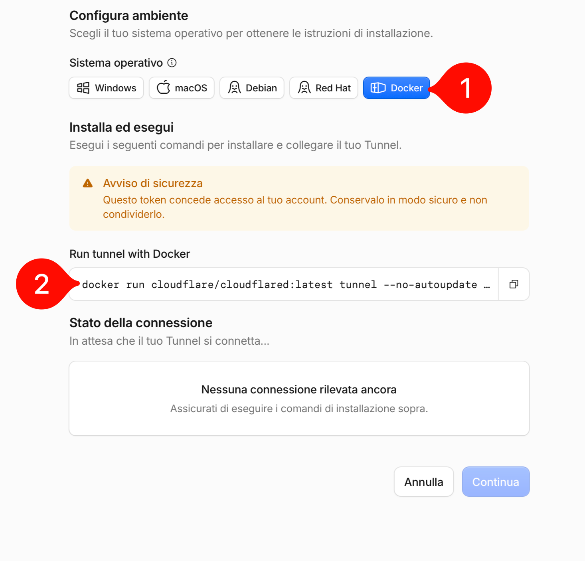

</details>

### 3. Avvia SkySend e attendi la connessione

1. Lascia aperta la scheda Cloudflare e fai doppio clic su **Avvia SkySend.command** nella cartella che hai estratto sul Mac.
2. Si apre il **Terminale**. Incolla il token con **⌘V** e premi **Invio**. Per riservatezza, i caratteri restano nascosti mentre incolli.
3. Alla voce **Sottodominio pubblico**, scrivi l’indirizzo completo che hai scelto, ad esempio `invii.studio.it`, e premi **Invio**.
4. Alla voce **Cartella di lavoro**, premi **Invio** per usare **Documenti → SkySend**. Se Documenti è sincronizzata con iCloud e vuoi tenere queste copie sul Mac, digita una cartella fuori da iCloud Drive, ad esempio `~/SkySend`, e premi **Invio**.
5. Il primo avvio può richiedere qualche minuto. Torna a Cloudflare e aspetta **Tunnel connesso con successo**, poi premi **Continua**.

Il pannello può aprirsi sul Mac già a questo punto. Per far funzionare i link dei clienti completa il passo 4.

<details>
<summary>Schermate del Terminale, di OrbStack e di Cloudflare</summary>

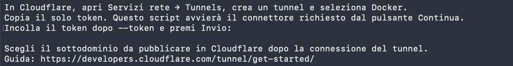

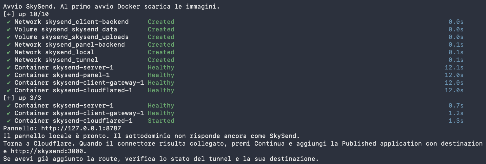

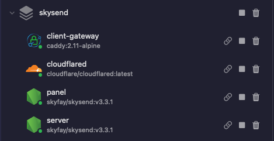


</details>

### 4. Collega il sottodominio al tunnel

In Cloudflare apri il tunnel **skysend**. Se sei nell’elenco dei tunnel, puoi anche scegliere **⋯ → Configura**. Lo stato **Sano** (*Healthy*) indica che il collegamento è attivo. Vai in **Rotte → Aggiungi rotta → Applicazione pubblicata**. La rotta dice a Cloudflare dove mandare le visite al tuo indirizzo. [Guida Cloudflare sull’aggiunta della rotta](https://developers.cloudflare.com/tunnel/get-started/#publish-an-application)

| Campo | Cosa inserire |
| --- | --- |
| **Sottodominio** | La prima parte dell’indirizzo, ad esempio `invii`. |
| **Dominio** | Il tuo dominio, ad esempio `studio.it`. |
| **Percorso** | Lascia vuoto. |
| **URL del servizio** | Scrivi `http://skysend:3000`. Se ci sono due campi, scegli **HTTP** e scrivi `skysend:3000` nell’altro campo. |

Controlla che **Hostname completo** coincida con l’indirizzo che hai scritto al passo 3. Premi **Aggiungi percorso** e attendi la conferma. Cloudflare crea automaticamente il record DNS che collega il sottodominio al tunnel. Ora puoi [provare i link](#prima-prova-con-un-file-fittizio). [DNS delle applicazioni pubblicate](https://developers.cloudflare.com/tunnel/concepts/routing/#published-applications)

<details>
<summary>Schermate per aggiungere la rotta</summary>


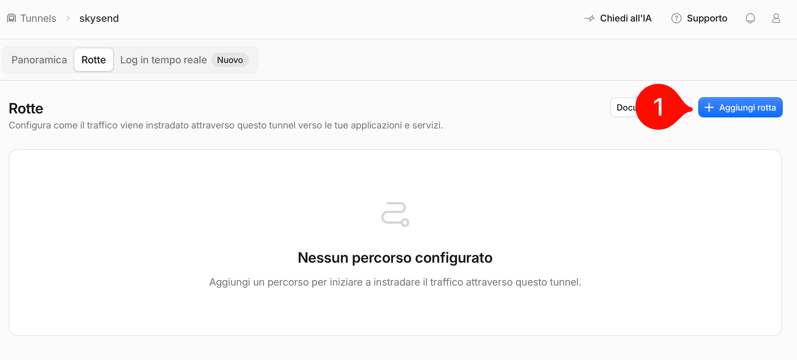

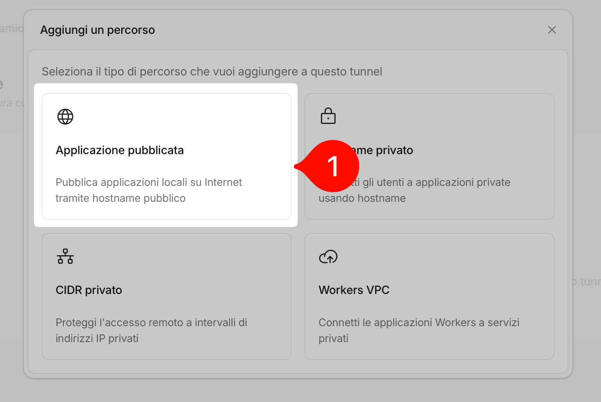


</details>

## Da usare ogni giorno

Sul Mac che ospita SkySend, apri **[http://127.0.0.1:8787](http://127.0.0.1:8787)**. Puoi salvare questo indirizzo nei preferiti. È l’indirizzo del **pannello dello studio**. Ai clienti mandi i link che copi dalla sezione **Link creati**.

In **Finder → Documenti → SkySend** trovi due cartelle. Se hai scelto un’altra posizione al primo avvio, cercale lì.

| Cartella | A cosa serve |
| --- | --- |
| **Download per i clienti** | Qui copi i documenti che vuoi inviare. |
| **Upload dai clienti** | Qui SkySend salva i documenti che ricevi. |

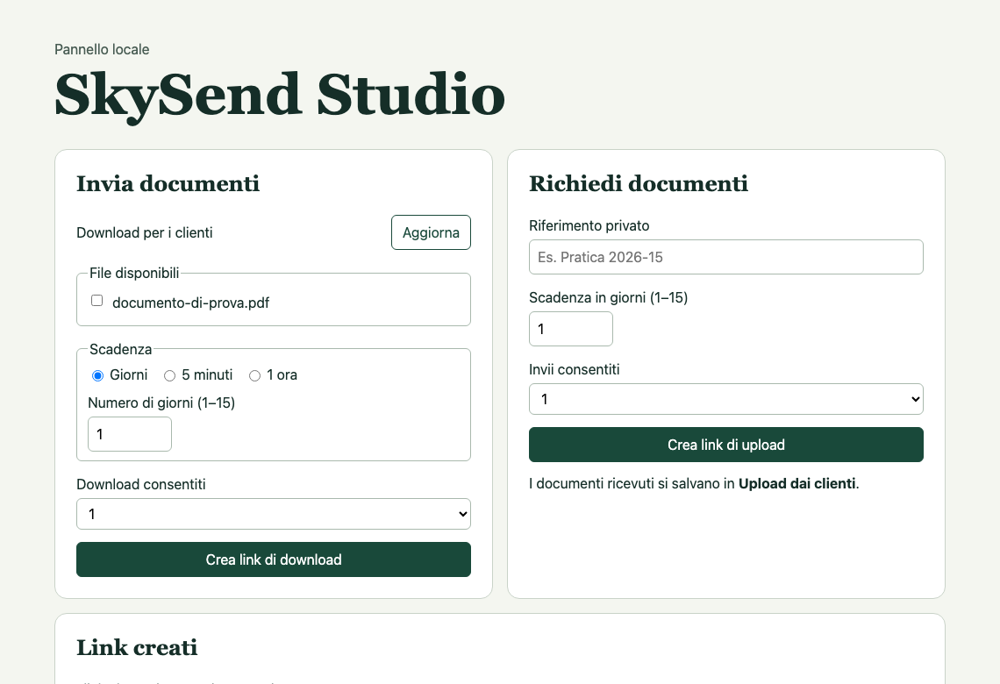

### Inviare documenti a un cliente

1. Copia i file in **Download per i clienti**.
2. Nel pannello, sotto **Invia documenti**, premi **Aggiorna** e spunta i file.
3. Imposta la scadenza. Puoi scrivere da **1 a 15 giorni** o scegliere **5 minuti** o **1 ora**. Poi indica quanti download vuoi consentire.
4. Premi **Crea link di download**. In **Link creati**, usa **Copia link** e invia il link al cliente. Usa **Copia password** e comunica la password su un altro canale, ad esempio per telefono.

Il cliente apre il link, inserisce la password, preme **Sblocca** e poi **Scarica**. Se devi bloccare i download successivi, premi **Revoca link** nel pannello.

<details>
<summary>Schermate dello studio e del cliente per il download</summary>

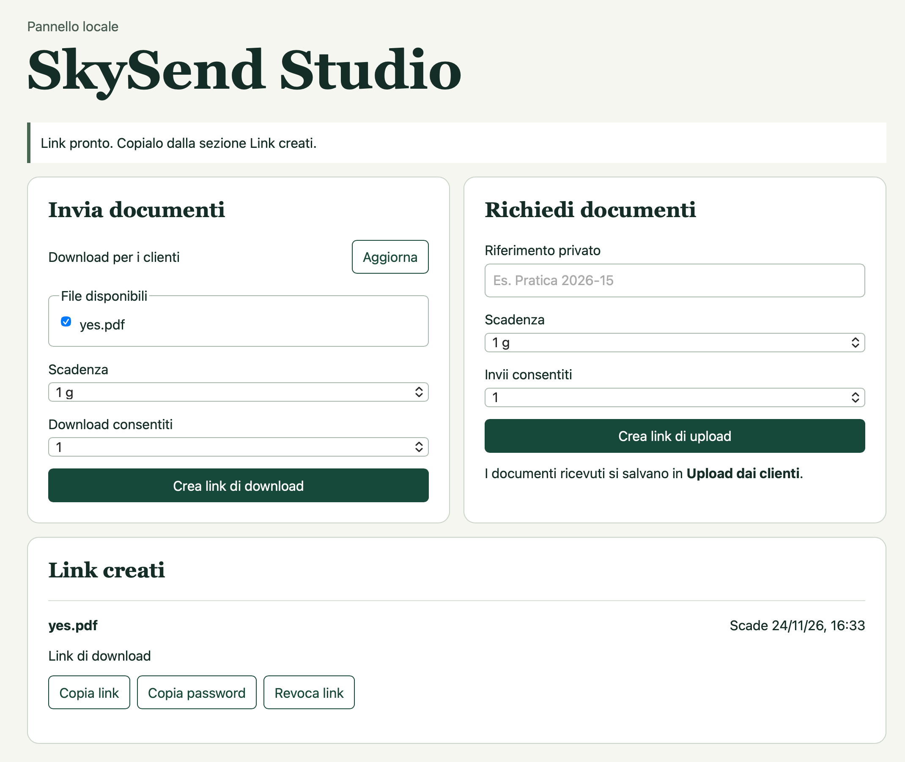

| 1. Sblocca il file | 2. Scarica il file |
| --- | --- |
|  |  |

</details>

### Chiedere documenti a un cliente

1. Nel pannello, sotto **Richiedi documenti**, scrivi un **Riferimento privato**, ad esempio il numero di pratica. Ti aiuta a ritrovare i file nel Finder.
2. Scrivi da **1 a 15 giorni** nel campo della scadenza e scegli quanti invii consentire. Ogni invio può contenere più file.
3. Premi **Crea link di upload**. Sotto **Link creati** premi **Copia link** e manda il link al cliente. Il link basta per caricare i documenti, quindi invialo soltanto a chi deve usarlo.
4. Dopo l’invio, cerca i file in **Upload dai clienti**. La sottocartella riporta il riferimento che hai scritto. Più file inviati insieme arrivano in un unico ZIP.

Il cliente apre il link, seleziona i file, tocca **Cifra e invia** e tiene aperta la pagina fino al messaggio **Consegnato**. Se devi impedire nuovi invii, premi **Chiudi richiesta** nel pannello. [Richieste di file SkySend](https://docs.skysend.app/user-guide/file-requests)

<details>
<summary>Schermate del cliente per il caricamento</summary>

Nel test su rete 4G, uno ZIP da **154,9 MB** ha impiegato alcuni minuti. Al termine il cellulare ha mostrato **Consegnato**.

| 1. Seleziona i file | 2. Attendi il caricamento | 3. Verifica la conferma |
| --- | --- | --- |
| 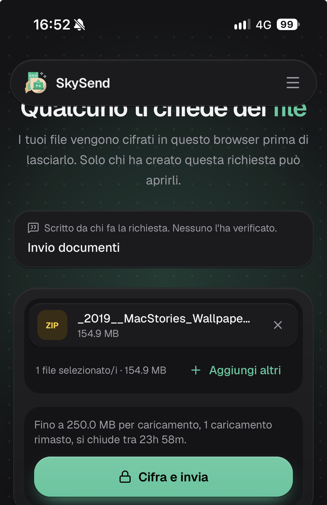 | 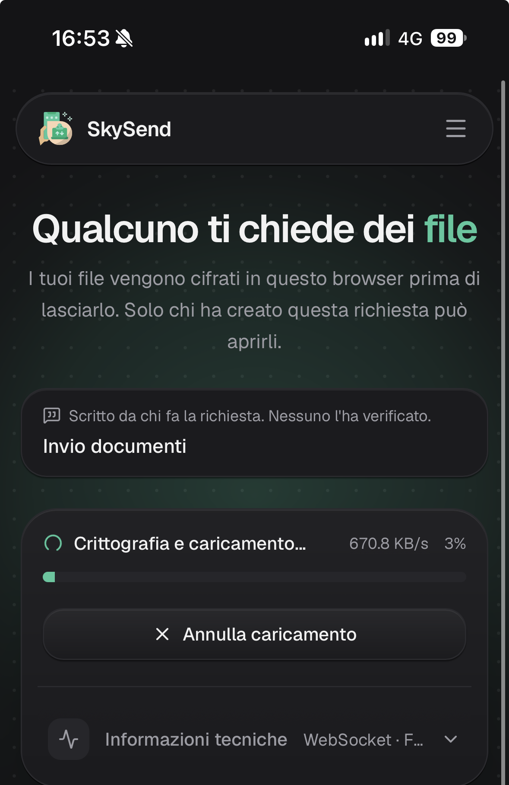 | 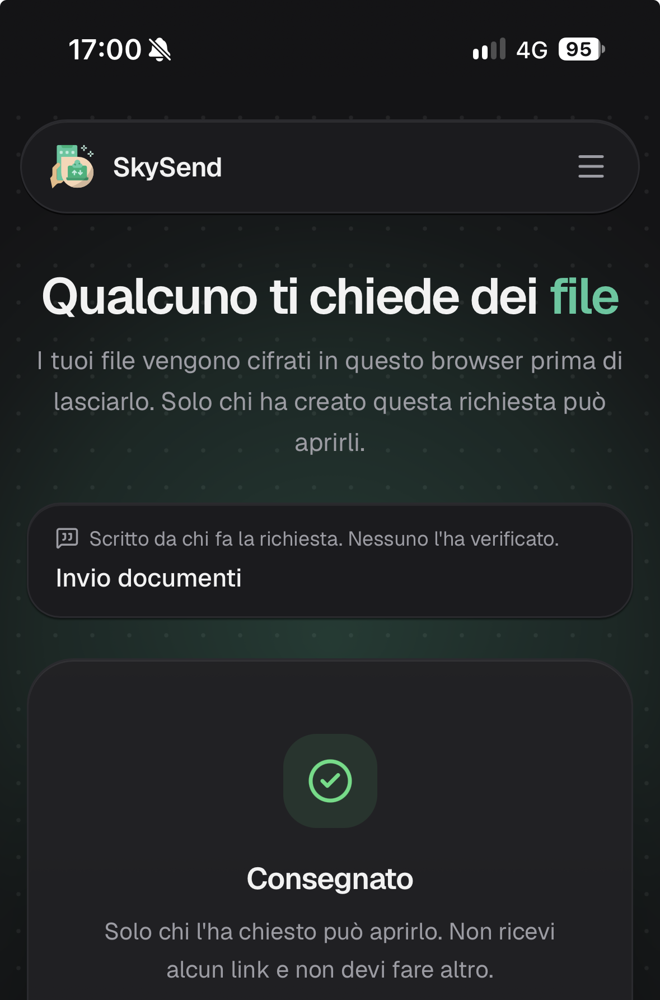 |

</details>

**Mentre i link sono attivi**, lascia il Mac acceso e connesso a Internet, con OrbStack in esecuzione. Puoi chiudere il browser. I documenti ricevuti vengono salvati anche a browser chiuso.

## Prima prova con un file fittizio

1. Crea un link di download. Aprilo dal telefono con il **Wi-Fi spento**, inserisci la password e scarica il file.
2. Crea un link di upload. Aprilo dallo stesso telefono, carica un file fittizio e attendi **Consegnato**.
3. Sul Mac controlla che il file sia comparso in **Upload dai clienti**. Il salvataggio locale può richiedere un po’ di tempo dopo la conferma sul telefono.

## Problemi comuni

| Cosa vedi | Cosa fare |
| --- | --- |
| **Il Mac non apre il file di avvio.** | Apri l’app **Terminale**. Scrivi `bash` seguito da uno spazio, trascina **Avvia SkySend.command** dal Finder nella finestra e premi **Invio**. |
| **Continua è ancora disattivato in Cloudflare.** | Avvia **Avvia SkySend.command**, incolla il token quando richiesto e aspetta che Cloudflare rilevi la connessione. |
| **Il browser sul Mac non apre il pannello.** | Apri OrbStack, fai doppio clic su **Avvia SkySend.command** e riprova da [http://127.0.0.1:8787](http://127.0.0.1:8787). |
| **Il sottodominio da solo mostra un errore 404.** | È previsto. Per la prova usa il link completo copiato da **Link creati**. |
| **Il cliente non riesce ad aprire il link.** | Controlla che il link sia completo e ancora valido. In Cloudflare verifica che il tunnel sia **Sano** e che la rotta punti a `http://skysend:3000`. Se l’hai aggiunta da poco, prova dal cellulare con il Wi-Fi spento. |

## Windows e Linux

L’avvio guidato con doppio clic è per macOS. Su Windows usa **Docker Desktop con WSL 2** e tieni progetto, cartelle di lavoro e stato nel filesystem della distribuzione WSL. Su Linux usa **Docker Engine 28 o successivo** e il plugin Compose. Il collaudo documentato è stato eseguito su Mac con OrbStack. [Docker Desktop e WSL](https://docs.docker.com/desktop/features/wsl/) · [Porte Docker pubblicate localmente](https://docs.docker.com/engine/network/port-publishing/)

<details>
<summary>Comandi per Windows e Linux</summary>

[Scarica ed estrai il progetto](https://github.com/avvocati-e-mac/skysend-studio/archive/refs/heads/main.zip) nell’ambiente in cui userai Docker. Segui i passi [1](#1-crea-il-tunnel-in-cloudflare) e [2](#2-copia-il-token-da-cloudflare) per ottenere il token. Apri un terminale Linux o WSL nella cartella del progetto ed esegui:

```sh
umask 077
cp -n .env.example .env
mkdir -p 'lavoro/Download per i clienti' 'lavoro/Upload dai clienti' stato secrets
chmod 700 stato secrets
```

Apri `.env` e sostituisci `SKYSEND_HOSTNAME` con il tuo sottodominio, senza `https://`. Imposta `SKYSEND_UID` e `SKYSEND_GID` ai valori restituiti da `id -u` e `id -g`. Salva il solo token in `secrets/tunnel-token`. Poi esegui:

```sh
chmod 644 secrets/tunnel-token
docker compose up -d --remove-orphans --wait
```

Quando Cloudflare rileva la connessione, completa il [passo 4](#4-collega-il-sottodominio-al-tunnel). Apri [http://127.0.0.1:8787](http://127.0.0.1:8787) nel browser. Le due cartelle dei documenti sono dentro `lavoro` e i dati privati del pannello sono in `stato`. In WSL, il comando `explorer.exe .` apre la cartella corrente in Esplora file.

</details>

## Dati e manutenzione

<details>
<summary>Cartelle da proteggere e backup</summary>

- I documenti leggibili sono nelle due cartelle di lavoro. Se Documenti è sincronizzata con iCloud, puoi scegliere una cartella fuori da iCloud Drive al primo avvio. [Apple Support](https://support.apple.com/en-asia/109344)
- Il pannello conserva password, chiavi e riferimenti delle richieste in `~/Library/Application Support/SkySend Studio` su Mac. Proteggi questa cartella e le sue copie. Il token del tunnel sta in `~/Library/Application Support/SkySend Studio Tunnel`.
- I documenti cifrati e i dati dei trasferimenti sono nei volumi Docker `skysend_skysend_data` e `skysend_skysend_uploads`. Per una copia coerente, ferma l’applicazione prima di esportare entrambi i volumi. In Finder li trovi sotto **OrbStack → docker → volumes**. [Volumi in OrbStack](https://docs.orbstack.dev/docker/file-sharing) · [Dati e backup SkySend](https://docs.skysend.app/user-guide/self-hosting/data-backups)

</details>

<details>
<summary>Configurazione avanzata e aggiornamenti</summary>

- **Verifica lo stato dei servizi.** Su Mac esegui dalla cartella del progetto `docker --context orbstack compose ps`. Per il registro del connettore esegui `docker --context orbstack compose logs --tail=40 cloudflared`. Su Windows e Linux ometti `--context orbstack`.
- **Cambia sottodominio o cartella.** Su Mac esegui `bash "Avvia SkySend.command" --configura`. Per sostituire anche il token usa `--configura-token`. Se il vecchio token era in `secrets/tunnel-token` dentro il progetto, sostituiscilo in Cloudflare. Se era stato condiviso, disconnetti anche i connettori sconosciuti. [Token di Cloudflare Tunnel](https://developers.cloudflare.com/tunnel/reference/tunnel-tokens/)
- **Verifica il DNS o le regole Cloudflare.** In **DNS → Record** cerca il CNAME del sottodominio. Se hai una regola che forza la cache, escludi questo sottodominio. Se usi Cloudflare Access, verifica che il requisito di login sul sottodominio non blocchi i link dei clienti. [Diagnosi DNS Cloudflare](https://developers.cloudflare.com/dns/troubleshooting/dns-issues/#newly-created-record-still-does-not-resolve) · [Regole di cache](https://developers.cloudflare.com/cache/how-to/cache-rules/create-dashboard/)
- **Ferma SkySend.** Su Mac usa `docker --context orbstack compose stop`. Su Linux e Windows usa `docker compose stop`.
- **Aggiorni dalla versione con login online.** Prima dell’aggiornamento salva i documenti già arrivati nelle vecchie richieste e chiudi quelle ancora aperte. I volumi conservano gli invii esistenti. Il nuovo pannello salva automaticamente i file delle richieste create al suo interno. I vecchi link conservano i limiti e le scadenze originali.
- **Dopo un aggiornamento**, ripeti la prova di invio e ricezione con file fittizi.

Il [Compose](compose.yaml) descrive i quattro servizi. Il [Caddyfile](Caddyfile) elenca le funzioni raggiungibili via tunnel e reindirizza a HTTPS le visite in HTTP. Il [filtro del browser](gateway/) rimanda al server le navigazioni verso schermate riservate. Queste pagine, compresa la pagina iniziale del sottodominio, rispondono con 404.

</details>

## Come è stato realizzato

SkySend Studio usa SkySend per cifrare e trasferire i file. Il pannello locale, le cartelle di lavoro, il salvataggio automatico dei documenti ricevuti, l’avvio guidato per Mac e il filtro per i link dei clienti sono personalizzazioni realizzate con l’ausilio dell’intelligenza artificiale.
